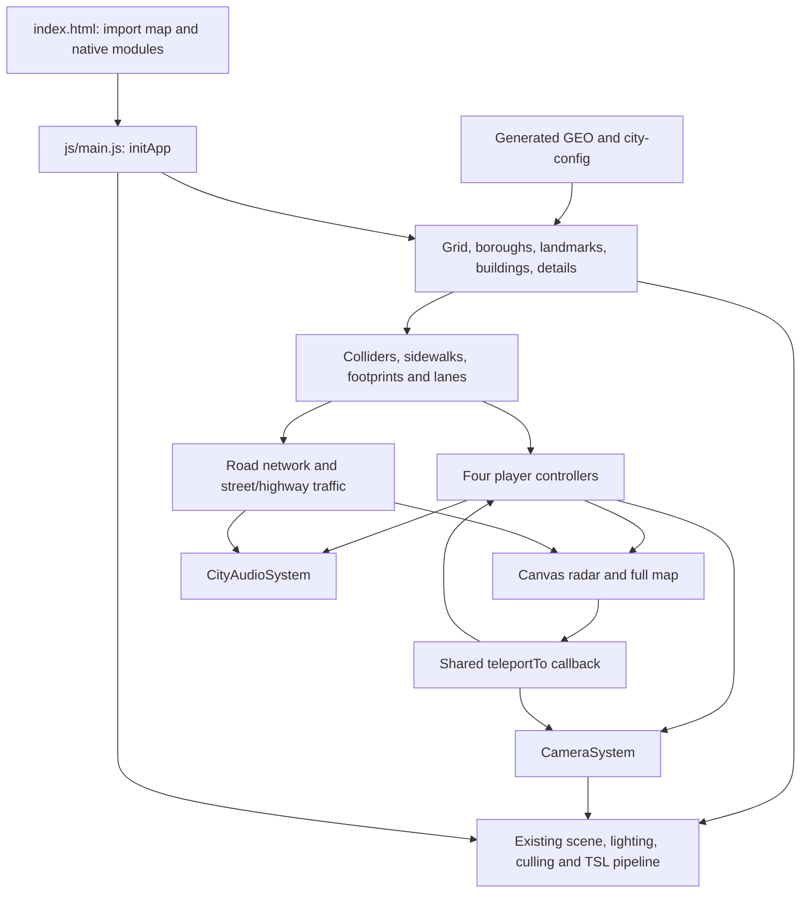

# Phase 0 — architecture and terminal integration survey

Inspected baseline: `cca9c12a096951d63fee1d26904c04be0a128cef`.
All coordinates and behavior below describe the imported source unless explicitly
marked as a proposal. No terminal, spawn override or educational code is installed.

## Repository-wide inventory

The baseline has 68 tracked files: five root files, one stylesheet, 29 runtime
modules, 13 test files plus one helper, eight tool scripts and eleven data/query
inputs. There is no package manifest, lockfile, application build, server backend,
test configuration or checked-in GitHub Actions workflow.

| Files | Responsibility and preservation boundary |
| --- | --- |
| `index.html`, `css/style.css` | Native import map and 29 module preloads; inline SVG icons; loading overlay; HUD, mode/camera/time controls, touch controls, teleport popover, radar and full-map dialog; responsive graphite/yellow visual system. |
| `js/main.js` | Composition root: constructs city/systems, restores and saves player state, wires HUD and controls, compiles shaders and owns the animation loop. No exported application API. |
| `js/nyc-geodata.js` | Generated geography in a single exported `GEO` object; source attribution and world frame in header. Not hand-authored game logic. |
| `js/city-config.js` | Converts GEO arrays into streets, avenues, blocks, landmarks and island bounds; spatial lookups, legacy-coordinate conversion, eight teleport presets, input-field guard and shared traffic-signal timing. |
| `js/city-grid.js` | Manhattan ground, raised sidewalks, parks, trees, waterfront/pier geometry, highways and viaduct; exports sidewalks, obstacle footprints, highway lanes and colliders. Static batching and park-site registries are shared with other builders. |
| `js/boroughs.js` | Surrounding land, land-use fields, low-detail neighborhood buildings, islands, bridges and Roosevelt Island tram. Returns bridge/tram colliders and tram animation update. |
| `js/buildings.js` | Procedural Manhattan building forms and oriented/axis-aligned colliders; `ManhattanQuadtree`, LOD/streaming and pooled storefront lighting. `allBlocks` also supplies map footprints. |
| `js/landmarks.js` | Detailed landmark models, fitted geographic sites, facade batching and landmark colliders; shares Bryant Park lawn height with controllers/cameras. |
| `js/street-details.js` | Trees, street furniture, signs, signals, lamps and steam; obstacle footprints, shared `signalClock`, audible signals and camera-dependent light updates. |
| `js/trees.js` | Procedural leaf atlas, species and branch/card geometry, instanced tree fields and per-camera LOD via chained scene render hooks. |
| `js/tsl-materials.js` | Shared city uniforms and TSL materials for buildings, interiors, roads, sidewalk/curb, foliage, water, steam, contact shadows and flares. Canvas/FFT-derived textures are generated locally. |
| `js/actor-models.js` | Loft geometry, body specifications and materials for cars, buses and helicopters, wheels, lightbars and body patches. Shared by player vehicles and traffic. |
| `js/pedestrians.js` | Procedural body geometry, GPU skinning/materials, instanced `PersonCrowd` and `PersonRig` with gait/IK, feet, jumping and rider poses. |
| `js/controllers.js` | Four persistent player entities; blended keyboard/touch/gamepad input, movement/physics, sidewalk/lawn height, collision queries/resolution and safe bounded teleport placement/reset. |
| `js/touch-controls.js` | Analog joystick, held buttons, per-pointer capture, mode availability and interruption/reset handling. |
| `js/gamepad-controls.js` | Standard-mapping controller polling, analog axes/triggers, button edges, mode/camera/map callbacks and focus/input suppression. |
| `js/cameras.js` | One perspective camera, eleven follow/scenic/director presets, smoothed chase/POV, mouse orbit, pinch/zoom, gamepad look and teleport reset. |
| `js/lighting.js` | Four time presets, physical sky/clouds, PMREM environment, aerial fog, clustered lighting integration and cascaded sun shadows. |
| `js/post-processing.js` | TSL color grading, exposure, selective half-resolution bloom, vignette and one final ACES/output transform; consumes scene color and reflections. |
| `js/scene-culling.js` | Spatially chunks large static instanced meshes, builds shadow proxies on layer 3, distance-culls props and coordinates precompile pipeline sharing. |
| `js/road-network.js` | Directed lane/sidewalk graph from real geography and built obstacles; intersections, turns, crosswalks and walkability. Separate from the map's drawn route. |
| `js/traffic.js` | 200 cars, 12 buses and 340 pedestrians; lane-following, signals/yielding, local actor replenishment, player collisions and sparks; separate highway traffic with elevation-aware player checks. |
| `js/road-paint.js`, `js/vehicle-lights.js` | Road lines/stop bars/crosswalks derived from the lane graph; shared headlight profile and placement for player/street/highway vehicles. |
| `js/nyc-map.js` | Canvas 2D radar and full map; tiled/cached paths and footprints, labels, search, zoom/pan, player/traffic, waypoint and drawn GPS route. Map click and preset travel share the main teleport callback. |
| `js/audio-system.js` | Gesture-unlocked Web Audio lifecycle, spatial emitters, bounded voice pools, listener/collision/horn coordination, mute preference and cleanup. |
| `js/audio-sources.js` | Collects nearby player/traffic/pedestrian/signal sound sources and derives movement/load parameters without changing physics. |
| `js/audio-synthesis.js`, `js/audio-events.js` | Procedural motor/rotor/bicycle/siren loops and transient footsteps/speech/horn/crash/wind synthesis. No external audio assets. |
| `js/audio-acoustics.js` | Cached local collision bounds and a small set of obstruction traces for muffling/reflections. |
| `tests/*.test.cjs`, `tests/*.test.mjs`, `tests/helpers/module.cjs` | Node-based source/function regression checks with explicit DOM/Three stubs; geographic and downloader subprocess tests. Coverage and limits are in `baseline-tests.md`. |
| `tools/geo-base.mjs` | Coordinate projection, geometry/raster helpers, local dataset reading and borough/coast preparation. |
| `tools/geo-streets.mjs`, `tools/geo-blocks.mjs` | Derive street/avenue centerlines and raster-cut buildable blocks/frontage frames. |
| `tools/geo-extra.mjs`, `tools/geo-roadgraph.mjs`, `tools/build-geodata.mjs` | Derive parks/piers/bridges/islands and Lower Manhattan graph, assemble/quantize GEO and write the generated module. |
| `tools/overpass.sh`, `tools/benchmark-pedestrians.mjs` | Validated atomic data downloader; optional real-Three math/IK CPU benchmark. Neither is needed to serve the city. |
| `tools/data/*` | Seven checked-in NYC/OSM JSON sources and four Overpass queries. Input structure/provenance was inspected; geographic records are data, not educational extension points. |
| `.gitignore`, `LICENSE`, `README.md`, `README-initial.md` | Ignore rule, MIT notice, original upstream description/data attribution and retained two-line project identity. |

## Runtime structure

Initialization order in `initApp()` is important:

1. Initialize WebGPURenderer, then the scene and lighting.
2. Build grid, boroughs, landmarks and procedural blocks; aggregate their player
   colliders. Build street details, traffic and highway traffic, then road paint.
3. Create controller entities, restore saved player state, then cameras,
   touch/audio systems; wire player-state lifecycle saves.
4. Set up static-root culling/shadow proxies and convert instance matrices to
   storage attributes. Compose the scene MRT, half-resolution SSR and final
   color-grade/bloom pipeline.
5. Wire HUD, gamepad, map and shared teleport behavior; initialize chase/golden UI.
6. Precompile shaders in a bounded pool and render warm-up/first frames before
   removing the loading overlay and enabling audio readiness.

Each frame clamps simulation dt to 0.001–0.05 seconds, advances input/controllers,
camera, shared signal time, traffic and highway traffic, periodic position saves,
tram/LOD/lights, map, audio and culling, then renders the existing pipeline.
HUD FPS uses wall time. A new terminal update should read the final active
entity position after movement/collision updates, without creating another loop.

## Original start and saved state

World coordinates use meters: +x is grid east, +z is grid south, y is elevation.
The origin is Fifth Avenue/42nd Street; grid bearing is 29.02° from true north.
The checked-in detailed Manhattan data spans z = -7090 to 6512 and contains
2,691 blocks, 3,246 road polylines and a lower-city graph of 1,823 nodes/2,717 links.

`controllers.js` uses `SPAWN_Z = streetZ(37)`, which is **398.6** in this snapshot.
The default active mode is car, with taxi position **(3.6, 0, 410.6)** and heading
**0**, facing +z toward the Empire State Building. Its x value is a literal 3.6;
it is not `avenueX('5') + 3.6` (the current avenue centerline is x = 0.4).
Person, cyclist and helicopter have their own original nearby initial positions.
Static HTML location text is placeholder UI, not the authoritative spawn.

`main.js` reads `nyc-player-state` version 1 from localStorage and restores every
valid entity using `teleportActiveTo`, then restores the active travel mode.
It saves every five seconds and on hidden/pagehide. Thus first visit has a fixed
taxi spawn, but return visits do not guarantee that start. `nyc-sound` separately
stores the audio preference. These behaviors remain unchanged in Phase 0.

**Phase 1 proposal:** an explicit educational-start configuration takes precedence
over the saved-position restore and starts the taxi at the original coordinates.
Preserve the original constructors/physics and unrelated audio preference.
Test stale saved positions and saved non-car modes, not just empty storage.

## Five proposed fixed terminal sites

Survey area: the Fifth Avenue sidewalks immediately south of 37th Street,
along the same block as the taxi start. Use stable T01–T05 IDs mapped by question
index, independently of unit/version or travel/camera mode.

| Terminal | Question | Proposed x | Proposed z | Relative to start / sidewalk |
| --- | --- | ---: | ---: | --- |
| T01 | Q01 | -12.0 | 422.6 | West sidewalk, about 20 m from taxi start |
| T02 | Q02 | 12.0 | 422.6 | East sidewalk, about 15 m from taxi start |
| T03 | Q03 | -12.0 | 442.6 | West sidewalk, about 36 m from taxi start |
| T04 | Q04 | 12.0 | 442.6 | East sidewalk, about 33 m from taxi start |
| T05 | Q05 when present | -12.0 | 462.6 | West sidewalk, about 54 m from taxi start |

These are concrete **proposed survey coordinates**, not approved or rendered
placements. The relevant GEO blocks are 1393 (west) and 1394 (east); their
buildable lot rectangles begin at x <= -13 and x >= 14 respectively, leaving
the proposed points in the sidewalk bands. A small base would nominally sit at
y = 0.22 (`ISLAND_BOUNDS.sidewalkHeight`). `blockAt()` includes curb/sidewalk
islands, so a non-null result alone does not imply a building collision.

Street furniture, real generated building colliders, pedestrian paths, marker
size and camera occlusion still require an actual scene survey in Phase 1.
Keep markers small and nonblocking. Do not delete trees, change curb widths,
reroute traffic or use runtime random searching to place terminals. If a site
conflicts, adjust it during review and then freeze the chosen coordinates.

## Additive integration points for Phase 1

| Existing point | Proposed narrow extension |
| --- | --- |
| Controller creation / saved-state block in `main.js` | Apply reviewed fixed educational startup before selecting the initial chase view. Preserve normal shared teleport handling. |
| After world/controllers exist, before shader precompilation | Create a separate five-marker scene group from an educational config. Keep it outside the existing named static city roots; do not rebuild city geometry. Construct before precompile so first interaction does not introduce shader compilation. |
| `getActiveEntity()` and end of simulation updates | Read player position for nearest eligible terminal. Use world distance plus ground/height checks, not camera/raycast-only proximity. Recompute after teleport/mode changes; airborne helicopter proximity must not trigger a ground question. |
| Global shortcut wiring | Add one guarded `KeyX` action for the nearest terminal; suppress repeats, modifier shortcuts, typing and competing dialogs. E is already helicopter ascent. |
| Existing DOM HUD composition | Add a scoped prompt/dialog using safe DOM APIs and accessible focus handling; leave city CSS/layout and original panels intact. |
| `resetInput()`, touch/gamepad enable/reset APIs, camera pointer reset | Coordinate input ownership on open/close/blur. One input reset does not stop inertia or block subsequent keyboard events. New dialog handlers must prevent original shortcuts from leaking through. |
| Single animation loop and signal clock | Use one explicit educational modal state for any temporary simulation suspension. Keep renderer, traffic/signal time and resume dt coherent; paused physics must not accumulate catch-up time. |
| Shared `teleportTo` callback / map callbacks | Preserve resolved safe placement, touch/gamepad reset, camera reset, chase selection and waypoint update. Question progress must survive map/preset teleportation. |

The full-map callback currently resets held input and disables touch/gamepad,
but does not pause physics or permanently disable keyboard movement. It is an
integration pattern, not a ready-made question pause. Pausing only controller
input would still permit car coasting and traffic impulses. A Phase 1 dialog
should coordinate the affected simulation steps without modifying their physics
equations; all city behavior resumes after closing it.

The current keyboard `isTypingInField` guard handles INPUT/SELECT only; gamepad
also checks TEXTAREA/contenteditable. Plan complete focus handling for question
controls and Escape/map interactions. Do not rely on the existing narrow helper
as a general modal lock. X has no existing binding; V cycles cameras, M opens the
full map, H toggles HUD, N toggles audio, B honks, digits select modes/cameras,
and E/Space/Q/C are flight/vertical controls.

## Architecture risks and review limits

- Cross-module geometry registries, shared uniforms, render hooks, collision
  grids and traffic inputs make renderer/world refactors broad changes. The
  educational layer should consume existing positions and expose limited state.
- Boot regression checks require exactly 29 canonical preloads. Later additive
  modules need an intentional preload/test inventory update, preserving the
  duplicate-import/canonical-URL checks.
- Map waypoints draw a simple grid-aligned route; they do not use the traffic
  lane graph as an educational routing engine. Leave this existing behavior.
- Existing tests exercise production functions through stubs/source extraction;
  they do not execute the whole WebGPU scene. Five marker visibility/clearance
  and modal input behavior need future real-browser tests and physical review.
- The floating Three.js dependency is a reproducibility risk, documented in
  `upstream.md`; changing it is outside Phase 0 and initial integration scope.
